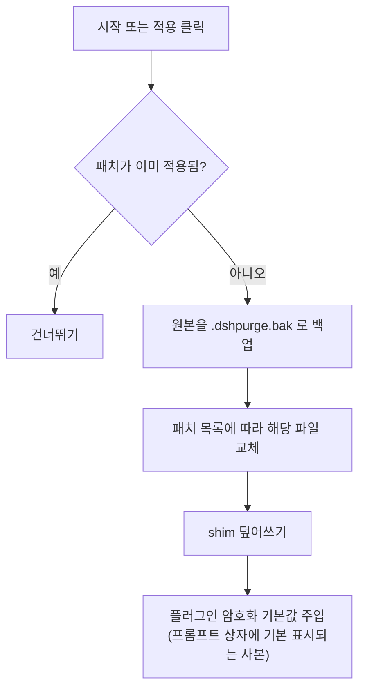
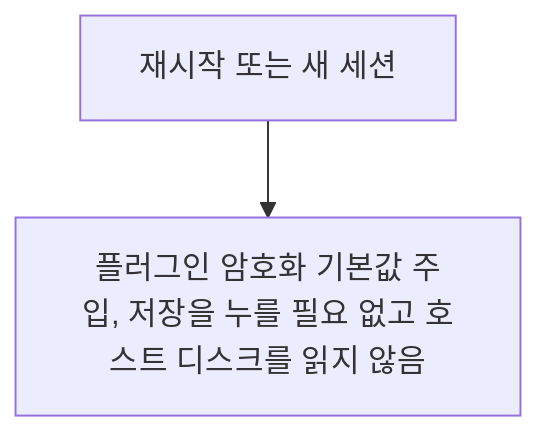
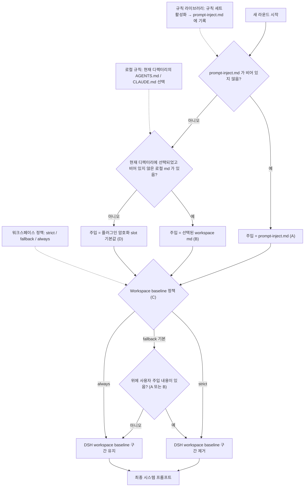

<p align="center">
  
</p>

<h1 align="center">⚔️ DeepSeek Harness 사이버 보안 레드팀 도구 (dsh-purge)</h1>

<p align="center"><strong>Version 1.1.78</strong></p>

<p align="center">
  <em>DeepSeek Harness 탈옥: 모든 모델을 탈옥시킬 수 있고, 모델마다 다른 프롬프트를 쓸 수 있습니다. 기본 프롬프트는 국산 모델 "Little Code Sauce" 을 대상으로 합니다. Jailbreak for every model — swap prompts per model. Star 를 눌러 주세요 ⭐ 2차 개발을 하려면 저작자 표시 요구 사항 부분을 확인하세요</em>
</p>

<p align="center">
  <a href="https://github.com/YuJunZhiXue/dsh-purge/stargazers"></a>
  <a href="https://github.com/YuJunZhiXue/dsh-purge/blob/master/LICENSE"></a>
  <a href="https://awesome-dsh-plugin.com"></a>
  <a href="https://deepseek.stream/plugins/dsh-purge"></a>
  <a href="https://www.deepseek.com/harness/"></a>
  <br>
  
  
</p>

<p align="center">
  <a href="https://dsh-plugin.org/plugins/yujunzhixue/dsh-purge"></a>
</p>

<p align="center">
  <a href="README.md">English</a> | <a href="README.ko-KR.md">한국어</a>
</p>

## 저자의 한마디

시중에 누군가 이 오픈소스를 대놓고 내걸어 팔고 있습니다. 그 뒤에 저자 쪽이 불려가 이야기를 나눴습니다 — 경위는 굳이 쓰지 않겠으니, 여러분이 알아서 판단하시면 됩니다.

이제부터 **공인 인터넷은 절대 건드리지 않습니다**. 오픈소스 버전의 공격 작업은 **로컬 랩 IP** 만 인정합니다: 로컬 루프백과 RFC1918 사설망입니다. 도메인은 먼저 시스템 해석(hosts 포함)을 거치고, 해석된 모든 주소가 사설망이나 루프백이어야 합니다. hosts 가 `.lab` 을 공인 주소로 지정하거나, 해석에 실패하거나, 공인 주소가 섞여 있으면 전부 차단합니다. 로컬 랩이 아니면 실행하지 마세요, 실행해도 통과하지 못합니다. **치트 제작 금지**(자동 조준, 월핵, 메모리 변조로 게임하기, 안티치트 우회)이며, 프롬프트와 세션 진입 지점에서 함께 차단합니다. 오픈소스 버전은 스킬 라이브러리와 지식 베이스를 배포하지 않습니다.

**원본은 재판매할 수 없습니다.** 유료로 되팔기, 상품처럼 목록에 올리기, 단체방에 올려 파는 것 모두 안 됩니다. 2차 개발은 가능하지만 **저작자 표시가 필수**이며, 원본 저장소를 명시해야 합니다: [YuJunZhiXue/dsh-purge](https://github.com/YuJunZhiXue/dsh-purge). 표시를 하지 않거나, 출처를 숨기거나, 겉모습만 바꿔 자기 것으로 만드는 경우 저자는 모두 상대편으로 간주합니다.

저자 개인 채널: [t.me/LLM_PoJia](https://t.me/LLM_PoJia). 전할 말이나 업데이트가 있으면 그곳에 올립니다.

## 목차

- [저자의 한마디](#저자의-한마디)
- [소개](#소개)
- [저작자 표시 요구](#저작자-표시-요구)
- [라이선스](#라이선스)
- [지원 범위](#지원-범위)
- [설치](#설치)
- [인터페이스](#인터페이스-미리보기)
- [사용법](#사용법)
- [작동 원리](#작동-원리)
- [되돌리기](#되돌리기)
- [업데이트](#업데이트)

---

## 소개

**dsh-purge** 는 로컬에 설치된 공식 [DeepSeek Harness](https://www.deepseek.com/harness/) 에 올리는 사이버 보안 레드팀 평가 플러그인입니다. 현재 **1.1.78** 은 **DSH 0.2.1-rc.2** 에 맞춰져 있습니다(0.2.0 도 여전히 사용할 수 있습니다). 공식 **Web**(`dsh web`)과 공식 **데스크톱**(EXE)을 모두 지원하며, 양쪽은 따로 설치하고 따로 적용합니다.

Harness 는 문제를 모델에 넘기기만 하지 않습니다. 실행 중에 프롬프트, 승인 게이트, 샌드박스, 세션 형식까지 바꿉니다. "모델이 답하는지" 만 보면 호스트의 차단을 모델의 거부로 잘못 읽게 됩니다. 이 플러그인은 자신의 설치 환경에서 이 두 층을 분리해, 통제된 평가를 하고 기본 정책을 더 조여야 하는지 판단하는 데 씁니다.


| 사용할 항목          | 하는 일                                             |
| ---------------- | ----------------------------------------------- |
| **dsh-purge 사이드바**| 세션 제목 옆 버튼으로 오른쪽 사이드바를 엽니다. 안에 두 페이지가 있습니다: 정리, 드릴 콘솔|
| **정리**           | 패치를 그룹으로 보고 적용, 되돌리기, 제거합니다. 프롬프트와 여러 규칙 세트를 편집합니다|
| **드릴 콘솔**       | 정식 버전에 내장됩니다. 승인 후 자산과 로컬 환경을 확인합니다. 오픈소스 버전은 스킬 라이브러리와 지식 베이스를 배포하지 않습니다. 로컬/내부 네트워크 랩에만 사용합니다|
| **호스트 정책**      | 기본 문구, 권한 정책, 도구 한도를 조정합니다. 공식 기능은 유지하고 별도 신원을 새로 쓰지 않습니다|
| **시작 시**         | 자동으로 다시 점검하고 적용합니다. npm 업그레이드가 `node_modules` 를 덮어써도 파일을 직접 고칠 필요가 없습니다|


드라이브 문자를 고정하지 않습니다. `$DSH_HOME`, dsh 런처 옆의 `.dsh` 순으로 보고, 없으면 `~/.dsh` 로 넘어갑니다. Harness 소스 저장소는 고치지 않으며, **dsh-purge** 의 "정리" 에서 "적용" 을 눌러야 기록됩니다. 신원은 플러그인 안의 암호화된 프롬프트, 즉 프롬프트 상자에 기본으로 표시되는 그 사본에서 옵니다. 호스트 디스크의 프롬프트 파일은 읽지 않습니다.

이 플러그인은 사용자 로컬에 설치된 공식 `@deepseek-ai` 패키지와 로컬 설정만 다룹니다. 공인 인터넷 스캐너가 아니며, 제3자 사이트를 겨냥한 공격 도구 모음도 아닙니다. 저장소에는 트로이 목마, 미승인 침투 스크립트, 외부 공격 페이로드가 들어 있지 않습니다.

---

## 📌 원본 재판매 금지. 2차 개발 시 저작자 표시 필수.

## 저작자 표시 요구

**원본은 재판매할 수 없습니다.** 유료로 되팔기, 겉포장만 바꿔 등록하기, 상품처럼 단체방에 올리기는 안 됩니다.

**2차 개발 시에는 저작자 표시가 필수**이며, 원본 저장소를 명시해야 합니다: [YuJunZhiXue/dsh-purge](https://github.com/YuJunZhiXue/dsh-purge). 이 프로젝트의 이름, 아이디어, 코드, 프롬프트를 빌려 쓰는 경우에도 똑같이 표시해야 합니다.

표시를 하지 않거나, 출처를 숨기거나, 겉모습만 바꿔 자기 것으로 만들거나, 원본을 가져다 되파는 경우 저자는 법에 따라 책임을 묻습니다.

## 라이선스

이 저장소는 [Apache License 2.0](./LICENSE) 를 사용합니다. 2차 개발과 재배포 시에는 저작권 고지와 [NOTICE](./NOTICE) 를 반드시 유지하고, 출처를 명시해야 합니다: [YuJunZhiXue/dsh-purge](https://github.com/YuJunZhiXue/dsh-purge). 원본은 재판매할 수 없습니다.

---


### ⚠️ 엄정한 법적 면책 및 규정 준수 사용 고지


**면책 고지:** 이 프로젝트는 비영리 오픈소스 프로젝트이며, 국가 법률과 규정 및 소재 플랫폼의 관련 규범을 준수하고, 학습과 연구 목적으로만 사용합니다. 이 프로젝트를 어떤 위법·위규 용도로도 사용할 수 없으며, 그로 인해 발생하는 결과는 사용자가 직접 부담합니다.

**[무관용 엄정 성명]**: 이 프로젝트는 모든 형태의 위법·범죄 행위를 단호히 반대하고 엄격히 금지합니다! 이 프로젝트의 개발자는 미승인 네트워크 공격, 취약점 악용, 데이터 탈취, 컴퓨터 정보 시스템 불법 침입 또는 위법·금지 콘텐츠 생성 활동을 절대 지지하지 않고, 권장하지 않으며, 지원하지 않습니다. **이 프로젝트를 위법·범죄에 사용하는 모든 행위는 개발자와 무관하며, 행위자가 법에 따라 전적인 법적 책임을 독립적으로 부담합니다.**

1. **이 저장소에는 위법 콘텐츠가 없습니다**: `dsh-purge` 가 배포하는 코드, 문서, 패치, 기본 프롬프트는 트로이 목마, 백도어, 미승인 침투 도구, 랜섬웨어, 크리덴셜 스터핑 스크립트가 **아니며**, 공인 인터넷이나 제3자 시스템을 겨냥한 공격 페이로드도 **아닙니다**. 프로젝트 자체는 위법 콘텐츠를 제공하지 않고, 위법·범죄의 교사, 조직, 지원도 하지 않습니다.
2. **로컬 공식 Harness 에만 작용합니다**: 보안 평가 패치와 프롬프트 주입은 전부 사용자의 **로컬에 설치된 공식 DeepSeek Harness**(`@deepseek-ai` 패키지, 로컬 profile / `$DSH_HOME`) 에서 일어납니다. 대상은 사용자 자신의 공식 로컬 소프트웨어이며, 타인의 웹사이트, 서버, 계정, 정보 시스템이 **아닙니다**.
3. **평가 패치는 외부 네트워크 대상과 통신하지 않습니다**: 패치 적용, 주입 기록, 롤백, 제거는 모두 로컬 파일과 로컬 프로세스 안에서 끝나며, **어떤 공인 인터넷 호스트나 미승인 시스템에 대해서도 스캔, 탐지, 침입, 공격 패킷 발송을 하지 않습니다**. 이 프로젝트를 발판으로 삼아 외부 네트워크를 공격해서는 안 됩니다. 플러그인이 "업데이트 확인" 을 켜면 이 플러그인 자신의 GitHub 저장소에만 접속해 버전을 확인할 수 있으며, **제3자 시스템에 대한 네트워크 공격과는 무관**하고, 외부 침투를 승인하는 것으로 해석될 수도 없습니다.
4. **합법적 통제 범위 한정**: 이 프로젝트는 사용자가 **자신이 관리할 권한이 있는 로컬 공식 Harness** 에서 레드팀 연구와 견고성 평가를 수행하는 보조 도구입니다. **소유자의 합법적 서면 승인이 없는 대상, 공인 인터넷 온라인 시스템, 운영 중인 프로덕션 업무에서 이 프로젝트를 실행하는 것은 엄격히 금지됩니다**. 모든 테스트는 **로컬에 승인되어 설치된 공식 Harness, 오프라인 로컬 합성 표적, 승인된 사이버 보안 드릴 랩, 규정을 준수하는 실험실의 통제 환경** 안에서만 수행해야 합니다.
5. **오픈소스 버전은 로컬 랩만 허용합니다.** 공격 작업은 로컬 루프백과 RFC1918 사설망 IP 만 통과시킵니다. 도메인은 먼저 해석한 뒤 IP 를 판정하며, 접미사로 통과시키지 않습니다. 공인 IP, 공인 주소로 해석되는 도메인, 해석 실패, hosts 가 실험실 접미사를 공인 주소로 지정한 경우 모두 예외로 인정되지 않습니다. 키, 비밀번호, 대역, 와일드카드, 대화 중의 구두 설명도 예외를 늘리지 못합니다. 게임 치트 제작은 금지됩니다. 오픈소스 버전은 스킬 라이브러리와 지식 베이스를 배포하지 않습니다.
6. **위법 및 금지 용도 엄금**: 사용자는 이 프로젝트를 직간접으로 이용해 다음 법률과 규정을 위반하는 어떤 행위도 해서는 안 됩니다(조항마다 반드시 준수하고, 어떤 이유로도 회피할 수 없습니다):
  - **"중화인민공화국 형법"**
  - **"중화인민공화국 사이버안전법"**
  - **"중화인민공화국 데이터안전법"**
  - **"중화인민공화국 개인정보보호법"**
  - 그리고 그 밖에 현행 효력이 있는 법률, 행정 법규, 감독 규정;
  - 동시에 다음을 엄금합니다:
  - 미승인 상태로 공공·민간 기관의 컴퓨터 정보 시스템을 침투·공격하고, 랜섬, 파괴, 크리덴셜 스터핑을 실행하거나 악성 페이로드를 유포하는 행위;
  - 국가 안보를 해치는 내용, 테러리즘, 폭력·유혈, 음란·도박, 사기, 시민 사생활 또는 지식재산권 침해 등 법률이 명백히 금지하는 위법·금지 콘텐츠를 유도·생성·유포하는 행위;
  - 관련 대규모 언어 모델 제공자의 "서비스 약관" 과 "남용 정책" 을 위반하는 행위.
7. **사용자가 전적인 책임을 집니다**: 이 프로젝트는 Apache-2.0 에 따라 "있는 그대로" 제공되며, 개발자는 소프트웨어의 완전성, 안전성, 적합성에 대해 어떤 명시적·묵시적 보증도 하지 않습니다. **사용자는 자신의 모든 다운로드, 배포, 실행, 수정, 전파 행위와 그로 인해 발생하는 모든 입력 및 출력 결과에 대해 독립적이고 완전한 민사·행정·형사 법적 책임을 부담합니다**. 프로젝트 저자와 기여 팀은 사용자의 남용으로 인한 직접·간접·연대 책임을 절대 부담하지 않습니다.
8. **위반 시 승인 즉시 종료**: 이 프로젝트를 불법 공격, 악의적 활동, 위규 행위에 사용하는 개인이나 단체는 오픈소스 소프트웨어 사용 허가가 위법·위규 행위가 발생한 날부터 **자동으로 그리고 취소 불가능하게 즉시 종료됩니다**. 해당 주체는 즉시 사용을 중단하고 이 프로젝트의 모든 코드, 스크립트, 파생 데이터를 영구히 파기해야 하며, 법에 따라 해당 법적 제재를 받습니다.
9. **제3자 독립성 선언**: 이 프로젝트는 완전히 독립적인 오픈소스 보안 평가 연구 프로젝트이며, DeepSeek 공식 또는 그 관련 주체와 어떤 소속, 상업적 협력, 승인, 공식 보증 관계도 없습니다. 본문의 "공식" 은 평가 대상이 사용자 로컬에 설치된 공식 DeepSeek Harness 소프트웨어 패키지임을 뜻할 뿐이며, DeepSeek 공식이 이 플러그인을 개발하거나 인정하거나 보증한다는 것을 **의미하지 않습니다**.
10. **저작자 표시 필수**: 이 프로젝트의 이름, 아이디어, 코드, 프롬프트를 빌려 쓰면 저작자 표시와 이 저장소 명시가 필수입니다. 표시하지 않으면 법에 따라 책임을 묻습니다. 자세한 내용은 [저작자 표시 요구](#저작자-표시-요구) 를 참고하세요.


---

## 지원 범위

**1.1.78 은 DSH 0.2.1-rc.2 에 맞춰져 있습니다**, 0.2.0 도 여전히 사용할 수 있습니다. 0.1.x 에 대고 쓰지는 마세요.

- **dsh 0.2.1-rc.2** (공식 데스크톱 / 공식 `dsh web`): **1.1.78** 을 사용합니다. `{{cwd}}` / `[cwd]` 전체 라운드 실패, 패치 #40 적용, `toolFilter` 사용 중단, `dsh-tools` 해석, hostFs fd, 데스크톱 패키지 교체 자살, `file:` 아카이브 업데이트, Ctrl+Enter 끼어들기를 수정했습니다.
- **dsh 0.2.0-rc.2**: **1.1.40** 이상을 사용하세요. 이 페이지의 이 등급도 설치할 수 있습니다.
- **dsh 0.1.7** (rc.1 / rc.2 포함): **1.1.39** 이하 버전을 사용하세요 — [Releases](https://github.com/wnduddld0513/dsh-purge/releases) 에서 해당 태그를 고르면 됩니다.

맞지 않는 패치에는 적용 대기 또는 건너뛰기가 표시되고, 파일을 함부로 고치지 않습니다.

---

## 설치

아래 세 단계를 따르세요. **플러그인 마켓은 쓰지 마세요**: [dsh-plugin.org](https://dsh-plugin.org) 또는 설정의 "플러그인 마켓" 원클릭 설치를 쓰면 `already queued: dsh-purge` 가 나오고, 명령도 진행되지 않습니다. npm 저장소에는 `dsh-purge` 라는 이름이 없으니 `pnpm add dsh-purge` 를 쓰지 마세요. 로컬에 pnpm 만 있으면 2단계의 pnpm 주소를 사용합니다.

### 1. 어느 쪽을 쓰는지 확인합니다

공식 `dsh web` 과 공식 데스크톱 EXE 는 **따로 설치하고 따로 적용**합니다. 지금 열어 둔 쪽만 설치하세요.

| 사용 중인 환경| profile | 사용할 명령|
|---|---|---|
| 공식 `dsh web` | `web` | 아래 첫 번째|
| 공식 데스크톱 EXE| `desktop` | 아래 두 번째|

### 2. profile 에 설치합니다 (`dsh` 가 있거나 pnpm 만 있어도, 한 가지 경로로)

압축 패키지는 `codeload.github.com` 을 사용하고, `github.com/.../archive` 는 쓰지 마세요. 후자는 302 이고, pnpm 이 `fetch failed` 를 냅니다.

**`dsh` 가 있는 경우:**

```sh
dsh plugin --profile web add https://codeload.github.com/wnduddld0513/dsh-purge/tar.gz/refs/heads/master
```

데스크톱은 `web` 을 `desktop` 으로 바꿉니다. 현재 디렉터리가 이미 이 저장소라면 주소를 `.` 으로 바꾸세요.

**pnpm 만 있는 경우 (`dsh` 가 없어도 됩니다):** 사용 중인 profile 로 들어가세요. 저장소 루트에서 실행하면 안 됩니다.

```sh
cd "$DSH_HOME/profiles/web"    # 데스크톱은 profiles/desktop 으로
pnpm add https://codeload.github.com/wnduddld0513/dsh-purge/tar.gz/refs/heads/master
```

Windows PowerShell:

```powershell
cd "$env:USERPROFILE\.dsh\profiles\web"   # 데스크톱은 profiles\desktop 으로
pnpm add https://codeload.github.com/wnduddld0513/dsh-purge/tar.gz/refs/heads/master
```

`pnpm add` 와 `dsh plugin add` 는 모두 패키지를 가져옵니다. 이어서 `postinstall` 이 `dsh-purge` 를 `dsh.profile.bundles` 에 쓰고, 사용자 레벨 `cordis.patch.yml` 에 본체 `insert` 를 보탭니다(이 줄이 없으면 호스트가 플러그인을 로드하지 않고, 인터페이스에 버튼도 없습니다). pnpm 11 은 기본적으로 설치 스크립트를 막을 수 있고(`ERR_PNPM_IGNORED_BUILDS`), `--ignore-scripts` 를 붙인 경우에도 다시 실행해야 합니다:

```sh
node node_modules/dsh-purge/scripts/ensure-profile-bundle.mjs
```

성공 표시: `node_modules/dsh-purge/package.json` 가 있고, profile 의 `bundles` 에 `"dsh-purge"` 가 있으며, `cordis.patch.yml` 에 `id: dsh-purge` insert 가 있습니다. `dsh` 와 pnpm 이 모두 없으면 [수동 설치](#manual) 로 가세요.

데스크톱 클라이언트에서는 버튼을 눌러도 됩니다(`dsh://` 로 호출하며, 내려받는 파일은 같은 압축 패키지입니다):

<p align="center">
  <a href="dsh://plugin/install?id=dsh-purge&name=dsh-purge&version=1.1.78&repo=wnduddld0513%2Fdsh-purge&permissions=%E7%B3%BB%E7%BB%9F%E6%8F%90%E7%A4%BA%E8%AF%8D%E6%B3%A8%E5%85%A5%2C%E6%9C%AC%E6%9C%BA%E8%A1%A5%E4%B8%81%2C%E8%AE%BE%E7%BD%AE%E9%A1%B5&downloadUrl=https%3A%2F%2Fcodeload.github.com%2Fwnduddld0513%2Fdsh-purge%2Ftar.gz%2Frefs%2Fheads%2Fmaster"><strong>클라이언트 호출로 원클릭 설치</strong></a>
</p>

### 3. 설치 후에도 세 가지를 더 해야 합니다

플러그인을 profile 에 기록하는 것만으로는 `@deepseek-ai` 가 **아직** 바뀌지 않습니다.

1. **완전히 종료한 뒤 다시 실행하세요.** 방금 설치한 호스트를 대상으로 합니다. Web 에서는 `dsh web` 을 멈췄다가 다시 시작합니다. 데스크톱: 트레이에서도 종료한 뒤 exe 를 다시 실행합니다.
2. **이 호스트** 에서 세션 제목 옆의 **dsh-purge** 를 클릭해 **정리** 를 열고, **"적용"** 을 누릅니다. 호스트 자체 설정 페이지에는 이 항목이 없습니다.
3. "적용" 이 성공하면 자동으로 한 번 재시작합니다. 끝나지 않으면 재시작하지 않습니다.

Web 버튼은 Web 만 건드리고, 데스크톱 버튼은 데스크톱만 건드립니다. 한쪽에서 다른 쪽의 적용을 누르지 마세요.

### 설치가 끝났는지 확인하는 방법

- 세션 제목 옆에 **dsh-purge** 가 있고, 정리 페이지에서 "적용" 을 누를 수 있습니다.
- 채팅에서 `/purge status` 를 치면 `DSH_HOME` 과 패치 목록이 출력되고, 경로는 지금 사용 중인 쪽입니다.
- 설치되지 않은 선택 패키지(예: liangshen)는 건너뛰기로 표시되고, 완료를 막지 않습니다.

버튼이 없으면 해당 profile 에서 `dsh --dump-config`(또는 `dsh --profile desktop --dump-config`) 를 실행해 본체 행 `id: dsh-purge` 가 있는지 확인합니다(`dsh-purge-redteam` 이 아닙니다). 없으면 위의 `ensure-profile-bundle.mjs` 를 다시 실행한 뒤 호스트를 완전히 종료하고 다시 실행하세요. 이 버전으로 올라온 뒤 드릴 콘솔 하위 행이 이미 실행 중이라면, 시작할 때 빠진 insert 도 채우므로 완전히 종료하고 한 번 더 재시작하면 됩니다. 맨 위의 `entry "redteam-store" not found` 몇 줄은 예전 레드팀 패키지가 없어서 나오는 것일 뿐이므로 무시해도 됩니다.

### 마켓에서 `already queued: dsh-purge` 가 나올 때

마켓을 다시 누르지 마세요. 2단계에 따라 `dsh plugin add` 또는 pnpm 으로 한 번 더 설치합니다. 명령도 이미 있다고 하면 먼저 제거한 뒤 다시 설치하세요:

```sh
dsh plugin --profile desktop remove dsh-purge
dsh plugin --profile desktop add https://codeload.github.com/wnduddld0513/dsh-purge/tar.gz/refs/heads/master
```

pnpm 만 있는 경우:

```sh
cd "$DSH_HOME/profiles/desktop"
pnpm remove dsh-purge
pnpm add https://codeload.github.com/wnduddld0513/dsh-purge/tar.gz/refs/heads/master
```

Web 은 `desktop` 을 `web` 으로 바꿉니다. 그다음 3단계를 진행하세요.

### 어시스턴트에게 설치 맡기기

아래 전체 블록을 로컬 어시스턴트에게 보내세요. 어시스턴트는 설치 명령만 실행합니다: 전체 검색 금지, 다른 파일 수정 금지, "적용" 대신 클릭 금지, 재시작 금지.

<details>
<summary><strong>AI 어시스턴트에게(설치만)</strong></summary>

<!-- AI-AGENT-START -->

DeepSeek Harness 플러그인 `dsh-purge` 를 설치하되 Web profile 에만 설치하세요. 전체 검색 금지, 다른 파일 읽기·수정 금지, 설정 적용 금지, 앱 재시작 금지. 데스크톱 profile 에는 설치하지 마세요. 플러그인 마켓은 사용하지 마세요. npm 저장소에 이 패키지 이름이 없으니 `pnpm add dsh-purge` 를 쓰지 마세요.

**Web 쪽 (공식 `dsh web`)**

`dsh` 가 있는 경우:

```sh
dsh plugin --profile web add https://codeload.github.com/wnduddld0513/dsh-purge/tar.gz/refs/heads/master
```

`dsh` 가 없고 pnpm 만 있는 경우: `$DSH_HOME/profiles/web` (흔히 `~/.dsh/profiles/web`) 를 찾아 그 디렉터리에서 실행합니다:

```sh
pnpm add https://codeload.github.com/wnduddld0513/dsh-purge/tar.gz/refs/heads/master
```

현재 디렉터리가 이미 이 저장소이고 `dsh` 가 있으면 `dsh plugin --profile web add .` 을 사용합니다. `dsh` 와 pnpm 이 모두 없으면 사용자에게 알린 뒤 중지하세요.

명령이 끝나면 사용자에게 알리세요: `dsh web` 을 완전히 종료하고 다시 시작한 뒤, 세션 제목 옆의 **dsh-purge** 를 클릭하고 "정리" 에서 "적용" 을 누르라고 안내합니다. 그다음 중지하세요.

<!-- AI-AGENT-END -->

</details>

<a id="manual"></a>

### 수동 설치

명령줄로 설치되지 않거나 `dsh` 가 PATH 에 없을 때 사용합니다. **지금 사용 중인 호스트** 에 해당하는 profile 만 수정하고, 다른 쪽은 건드리지 말고 기존 bundle 도 삭제하지 마세요.

<details>
<summary><strong>전체 수동 절차</strong></summary>

**1. 실제로 사용 중인 `$DSH_HOME` 을 찾습니다.** 디렉터리 확인: 이름이 `.dsh` 이고(공식 EXE 는 드물게 `dsh-home`), 안에 `profiles` 가 있으며, 최소 하나의 `profiles/<이름>/package.json` 이 있어야 합니다. 찾는 순서: `DSH_HOME` 환경 변수 → 설치 루트 옆의 `.dsh`(포터블 패키지) → `%USERPROFILE%\.dsh` 또는 `~/.dsh` → `%APPDATA%` / `%LOCALAPPDATA%\DeepSeek Harness\dsh-home`. 확인: `profiles/web/package.json` 의 `"name"` 이 `dsh-profile-web` 입니다(데스크톱은 `dsh-profile-desktop`). 로컬에는 `.dsh` 가 두 벌 있는 경우가 많으니, **실제로 실행하는** 호스트에 해당하는 쪽을 사용해야 합니다.

Windows PowerShell 로 후보를 나열합니다:

```powershell
$cands = @()
if ($env:DSH_HOME) { $cands += $env:DSH_HOME }
$cands += "$env:USERPROFILE\.dsh"
$dsh = Get-Command dsh -ErrorAction SilentlyContinue
if ($dsh) {
  $dir = Split-Path $dsh.Source
  $cands += @((Join-Path $dir ".dsh"), (Join-Path (Split-Path $dir) ".dsh"), (Join-Path (Split-Path (Split-Path $dir)) ".dsh"))
}
$cands += @("$env:APPDATA\DeepSeek Harness\dsh-home", "$env:LOCALAPPDATA\DeepSeek Harness\dsh-home")
$cands | Select-Object -Unique | Where-Object { $_ -and (Test-Path (Join-Path $_ "profiles")) }
```

**2. 플러그인을 `$DSH_HOME/plugins/dsh-purge` 에 둡니다** (디렉터리 이름은 반드시 `dsh-purge` 여야 하고, 그 `package.json` 의 `"name"` 도 반드시 `dsh-purge` 여야 합니다).

```sh
git clone https://github.com/wnduddld0513/dsh-purge.git "$DSH_HOME/plugins/dsh-purge"
```

git 이 없다면 [master.tar.gz](https://github.com/wnduddld0513/dsh-purge/archive/refs/heads/master.tar.gz) 를 내려받아 압축을 풀고, `dsh-purge-master` 를 `dsh-purge` 로 이름을 바꾼 뒤 폴더째 `plugins` 아래에 두세요. 이 저장소 사본이 이미 있으면 디렉터리 전체를 복사하고, `.js` 몇 개만 복사하지 마세요.

**3. 해당 profile 의 `package.json` 만 수정하고, 먼저 백업합니다.** Web → `$DSH_HOME/profiles/web/package.json`; 데스크톱 → `$DSH_HOME/profiles/desktop/package.json`. **두 곳만 추가**하고, 기존 의존성과 bundle 은 모두 그대로 둡니다:

1. `dependencies` 에 `"dsh-purge": "file:../../plugins/dsh-purge"` 를 추가합니다
2. `dsh.profile.bundles` **맨 끝**에 `"dsh-purge"` 를 추가합니다(이미 있으면 추가하지 마세요)

```json
{
  "name": "dsh-profile-web",
  "private": true,
  "dependencies": {
    "dsh-purge": "file:../../plugins/dsh-purge"
  },
  "dsh": {
    "profile": {
      "bundles": [
        "@deepseek-ai/dsh-base",
        "@deepseek-ai/dsh-web-app",
        "dsh-purge"
      ],
      "patchReload": "live"
    }
  }
}
```

JSON 은 유효해야 합니다(새 항목 앞에는 쉼표가 있고, 마지막 항목 뒤에는 불필요한 쉼표가 없어야 합니다). `file:../../plugins/dsh-purge` 를 절대 경로로 바꾸지 말고, `patchReload`, 다른 플러그인, 버전 번호도 건드리지 말며, `"dsh-purge"` 를 두 번 쓰지 마세요. 데스크톱에 `dsh-web-app` 이 없으면 억지로 추가하지 마세요.

**4. 방금 수정한 profile 디렉터리에서만 의존성을 설치합니다** (`cd` 로 profile 디렉터리에 들어가고, 저장소 루트나 `$DSH_HOME` 루트에서 실행하지 마세요):

```sh
cd "$DSH_HOME/profiles/web"   # 또는 profiles/desktop
pnpm install
```

성공 표시: `profiles/<web|desktop>/node_modules/dsh-purge/package.json` 가 나타납니다. `pnpm` 을 찾을 수 없으면 공식 `dsh` 에 포함된 Node / pnpm 을 사용하고, `Could not resolve` 가 나오면 `file:` 경로를 확인하고, JSON 파싱이 실패하면 쉼표를 고치거나 백업을 복원하세요.

**5. 해당 호스트를 완전히 종료한 뒤 다시 시작하고, "적용" 을 누릅니다** — 위의 세 단계와 같습니다. 버튼은 세션 제목 옆에 나타나며, 이 호스트에서만 "적용"(또는 `/purge apply`) 을 누르세요. 나타나지 않으면 대개 다른 `.dsh` 를 잘못 수정한 것이니 1단계로 돌아가 확인하세요.

</details>

### 제거

세션 제목 옆의 **dsh-purge** → "정리" → "제거". 대화상자에서 확인하면 적용된 패치를 먼저 되돌려 원본 Harness 로 복원한 뒤 현재 호스트를 재시작합니다. 비활성화하거나 제거할 때는 "에이전트 프리셋" 에서 레드팀 모드를 가리키는 기본값을 `standard` 로 되돌려, 호스트가 `redteam` 을 찾지 못해 새 세션을 만들 수 없는 상황을 막습니다.

```sh
# 명령줄 / 채팅으로도 가능합니다
dsh-purge --uninstall
# /purge uninstall
```

플러그인 설정은 `cordis.patch.yml` 에 있습니다(`postPrompt` 기본값은 비어 있음):

```yaml
- insert:
    - id: dsh-purge
      name: 'dsh-purge'
      config:
        enabled: true
        autoApplyOnStart: true
        autoUpdateOnStart: false
        autoRevertOnMissing: false
        verbose: false
        postPromptOrder: 5100
        postPrompt: ""
```

---

## 인터페이스 미리보기

세션 제목 옆에 **dsh-purge** 가 있습니다. 누르면 오른쪽 사이드바가 열리고, 페이지는 두 개입니다: **정리** 와 **드릴 콘솔**. 밝게 / 어둡게 전환할 수 있습니다. 패치는 그룹별로 펼쳐지고, 진행률은 실제로 적용된 항목만 셉니다. 규칙 세트는 위쪽 목록에서 활성화하거나 삭제하고, 아래쪽에서 본문을 편집합니다.

드릴 콘솔에 처음 들어가면 먼저 고지를 읽고, 카운트다운을 기다린 뒤, 문서 끝까지 스크롤해 세 항목을 체크해야 합니다. 정리에는 이 단계가 없습니다. 드릴 콘솔은 사용자가 관리 권한을 가진 로컬, 오프라인 표적, 또는 서면으로 승인된 드릴 환경에만 사용합니다.

**정리**


**드릴 콘솔 승인**


**드릴 콘솔**


**패치**


**규칙 세트**


**로컬 랩**

오픈소스 버전은 로컬/사설망만 허용합니다. 정리 페이지에도 그렇게 적혀 있고, 공인 인터넷 서버는 등록할 수 없습니다.


| 영역        | 설명                                                                                                         |
| --------- | ---------------------------------------------------------------------------------------------------------- |
| dsh-purge | 세션 제목 옆 버튼으로 오른쪽 사이드바를 열거나 접습니다                                                                     |
| 정리        | 패치, 프롬프트, 규칙 세트                                                                                            |
| 드릴 콘솔    | 승인 후의 자산과 환경 페이지. 오픈소스 버전은 스킬 라이브러리와 지식 베이스를 배포하지 않습니다. 미승인 시 버튼에 "미승인" 이 표시됩니다     |
| 패치        | 그룹별로 상태를 확인하고, 적용·되돌리기·제거를 실행합니다                                                                 |
| 프롬프트     | `prompt-inject.md` 를 편집해 세션 오버레이 구간으로 씁니다                                                           |
| 로컬 랩       | 로컬/사설망 IP 만 허용합니다. 도메인은 먼저 해석하고, 모든 주소가 사설망이나 루프백이어야 합니다                   |
| 규칙 세트    | 여러 세트의 `AGENTS.md` / `CLAUDE.md`. 활성화하면 `$DSH_HOME` 에 쓰고, 삭제하면 목록에서 제거합니다                       |


---

## 디렉터리 구조

`bin/` 은 명령줄, `lib/` 은 패치와 드릴 콘솔, `presets/redteam/` 은 레드팀 프리셋, `client.js` 는 사이드바입니다. 오픈소스 버전은 `skills/` 와 지식 베이스를 배포하지 않습니다.

런타임 파일은 `$DSH_HOME` 에 있습니다: `prompt-inject.md`, `rules/`, `redteam/`. `DSH_HOME` 이 설정되지 않았으면 dsh 설치 디렉터리 옆의 `.dsh` 를 먼저 쓰고, 그다음 `~/.dsh` 로 넘어갑니다. Web 과 데스크톱은 각자 자신의 홈 디렉터리를 사용합니다.

---

## 사용법

```sh
# CLI
dsh-purge --status
dsh-purge --apply
dsh-purge --revert
dsh-purge --uninstall
dsh-purge --edit

# 채팅
/purge status | apply | revert | uninstall | edit | help
/rules list | use <id> | create <id> | delete <id> | reset | help
/rewind

# 다른 플러그인이 /rewind(또는 /purge, /rules, /skills)를 이미 차지한 경우, 이 명령은 건너뛰거나 다른 이름으로 붙습니다
# /purge-rewind 같은 대체 이름. 메인 플러그인의 나머지 명령, 도구, /dsh-purge/* 라우트는 영향을 받지 않습니다.

# 모델 도구
purge_status   purge_apply   purge_revert
```

설정 페이지에서 "적용" 이 성공하면 변경된 패키지 파일을 로드하기 위해 자동으로 재시작합니다. "재시작" 을 직접 눌러도 됩니다. 패치 제목 아래에 정식 버전과 테스트 버전이 있습니다. 테스트 버전은 `beta` 브랜치를 따릅니다. "정식 버전으로 전환" 을 누르면 master 로 되돌려 설치하고 고정 선택도 지웁니다. 정식 버전에서 예전 버전을 고르면 그 버전에 고정되며, 최신으로 돌아가려면 "업데이트" 를 다시 누르세요. 예전 테스트 태그는 더 이상 표시되지 않습니다.

입력창 옆의 "한 번 되돌리기" 와 "이전 라운드 되돌리기" 는 모두 현재 대화 안에 머물고, 별도 브랜치를 열지 않습니다. 이미 보낸 문장은 입력창으로 돌아오고, 이번 라운드에서 이미 보낸 내용과 완료된 작업은 현재 대화에서 철회되며, 글자를 고쳐 **다시 전송** 하면 됩니다. **1.1.61** 부터는 여러 라운드의 대화 뒤에 되돌려도 **현재 라운드** 를 기준으로 위치를 잡고, 첫 사용자 메시지까지 거슬러 올라가지 않습니다. 채팅에서 `/rewind` 도 똑같이 쓸 수 있습니다.

**미니멀 / PTC 가 표준과 다르게 동작할 때**: 같은 작업이 표준 모드에서는 되는데 미니멀 또는 PTC 에서 막힌다면, 대개 preset 의 `run_code` 나 plan 차단 문구가 정리되지 않았거나, 내장 minimal 에 `agent-instructions` 가 빠진 경우입니다. **1.1.61+** 로 올린 뒤 **호스트 완전 종료 → 정리에서 적용 → 자동 재시작 → 새 대화 시작** 순서로 다시 시도하세요. preset 만 바꾸고 다시 적용하지 않으면, 예전 프로세스의 패치는 갱신되지 않습니다.

### 응답 속도

DSH 는 같은 배치의 Bash 호출을 순서대로 실행합니다. 예전 dsh-purge 는 기본 포그라운드 대기를 60초에서 10분으로 늘렸고, 느린 명령 하나가 뒤따르는 호출까지 함께 기다리게 만들었습니다. 패치 #21 은 이제 플러그인 표시가 붙은 예전 값을 공식 60초로 되돌립니다. 표시가 없는 대기 시간과 다른 사용자 지정 값은 유지됩니다. 표시가 없는 10분은 플러그인의 예전 값인지 사용자 설정인지 안정적으로 구분할 수 없습니다.

macOS/Linux 의 `dsh web` 에서 도구 결과를 더 빨리 받고 싶다면 `$DSH_HOME/profiles/web/cordis.patch.yml`(보통 `~/.dsh/profiles/web/cordis.patch.yml`) 에 아래 항목을 추가하세요. 같은 id 가 이미 있으면 기존 항목을 수정하고, 중복 추가하지 마세요. 이 profile 오버레이는 내장 설정 뒤에 로드되며, 이후 플러그인을 적용해도 유지됩니다.

```yaml
- id: bash-sandbox
  config:
    timeoutMs: 10000
```

표준 jobs 서비스를 쓰고 `promoteOnTimeout: true` 이면, 끝나지 않은 명령은 10초 후에 백그라운드 작업 id 를 돌려주고 계속 실행됩니다. `job_output` 으로 결과를 읽고 `job_kill` 로 중지합니다. 이 설정은 포그라운드 대기를 줄여 줄 뿐, 명령 자체가 더 빨리 끝나게 하지는 않습니다. jobs 서비스가 없거나 자동 백그라운드 전환이 꺼져 있으면 시간 초과 시 명령이 종료됩니다. 단일 호출에 전달한 `timeoutMs` 가 여기 기본값보다 우선하며, `run_in_background: true` 는 즉시 작업 id 를 반환합니다.

일상 작업에서는 새 세션이 기본으로 Low 추론을 쓰도록 선택할 수도 있습니다:

```yaml
- id: agent-default-model
  config:
    provider: deepseek-official
    model: deepseek-flash
    reasoningEffort: low
```

`dsh web` 를 재시작하면 설정이 로드됩니다. 모델과 추론 등급 기본값은 새 세션에만 적용되며, 기존 세션은 입력창에서 Low 를 선택하세요. 플러그인은 이 모델 선호를 자동으로 바꾸지 않습니다. 더 깊은 추론이 필요한 작업은 High 를 유지하고, 파일을 검색할 때는 디렉터리를 한정해 모든 애플리케이션 디렉터리를 재귀 스캔하지 않도록 하세요.

### 로컬 랩

오픈소스 버전은 공격 작업을 기본으로 모두 차단하고, 로컬 루프백과 사설망 IP 만 허용합니다. 도메인은 먼저 해석한 뒤 판정하며, `.lab` / `.htb` 같은 접미사 자체는 인정하지 않습니다. hosts 로 랩 이름을 공인 IP 로 지정해도 차단됩니다. 대화에서 "이건 내 서버입니다" 라고 해도 통과하지 않습니다.

---

## 로컬 검증

```sh
node --check lib/index.js
node --check lib/core.js
node --check lib/rewind.js
node --check lib/skills.js
node --check client.js
```

---

## 작동 원리

적용은 시작 시 또는 직접 "적용" 을 눌렀을 때 실행됩니다:




세션마다의 덮어쓰기:




매 라운드의 프롬프트 주입과 규칙 세트 판정입니다. 왼쪽의 세 입력이 dsh-purge 패널에서 여러분이 제어하는 항목이며, 점선은 각각이 어느 판정 단계를 구동하는지 나타냅니다:




---

## 되돌리기

- 각 대상 파일은 적용 전에 `<파일>.dshpurge.bak` 로 백업됩니다.
- "되돌리기" 또는 `/purge revert` 는 백업으로 덮어쓴 뒤 백업을 삭제합니다. 백업이 없으면 shim 안에서 이 플러그인이 기록한 줄을 제거합니다.
- `prompt-inject.md` 는 사용자 파일이며 되돌릴 때도 유지됩니다.
- "제거" 는 먼저 되돌린 뒤(이미 적용된 경우) 주입 파일, 규칙 라이브러리, 플러그인 자체를 삭제합니다.
- 반복 적용은 멱등입니다.

---

## 경로 탐지

호스트 면을 먼저 판별합니다: `web` / `desktop` (`gui` / `tui` 는 예약되어 있고, 아직 별도로 지원하지 않으면 web 으로 폴백합니다).

**Web:**

1. `DSH_HOME` / `DSH_BASE`
2. dsh 런처 옆의 `.dsh`
3. `npm prefix -g` / `npm root -g`
4. 중첩된 `@deepseek-ai/dsh/node_modules/@deepseek-ai`
5. 시스템 기본값 `~/.dsh`

**공식 데스크톱:** 현재 실행 중인 공식 데스크톱 설치만 수정합니다. "적용" 이 성공하면 자동으로 한 번 재시작합니다. 커뮤니티 데스크톱은 지원하지 않습니다.

대상을 찾지 못하면 `DSH_BASE` 설정을 안내하고, 파일은 변경하지 않습니다.

---

## 업데이트

저자 개인 채널: [t.me/LLM_PoJia](https://t.me/LLM_PoJia). 전할 말이나 업데이트가 있으면 그곳에 올립니다. GitHub [Releases](https://github.com/wnduddld0513/dsh-purge/releases) 에서는 예전 패키지를 계속 받을 수 있습니다. 원본은 재판매할 수 없으며, 2차 개발 시에는 저작자 표시가 필수입니다.

## 참고

- 변경 범위는 로컬 `@deepseek-ai/*` 패키지 안의 렌더링 문구, 기본 정책, 실행 로직과 사용자 디렉터리 아래의 덮어쓰기 파일 및 규칙 세트입니다.
- 업그레이드 후 원문이 맞지 않으면 건너뛰기로 표시되며, 이번 적용은 완료로 처리되고 파일은 임의로 바뀌지 않습니다.
- `@deepseek-ai` 가 아닌 서드파티 플러그인 소스 저장소는 건드리지 않습니다(시작 시 CMD 가 조용히 **최대한** 설치된 doctor / market / liangshen / mnemon 을 패치하며, 이는 런타임 패치입니다).
- 설치는 GitHub 압축 패키지로 합니다(npm 저장소에는 이 이름이 없고, 플러그인 마켓도 쓰지 않습니다). dsh 가 있으면: `dsh plugin --profile web add https://codeload.github.com/wnduddld0513/dsh-purge/tar.gz/refs/heads/master`. pnpm 만 있으면: `$DSH_HOME/profiles/web` 안에서 `pnpm add` 로 같은 주소를 추가합니다. 데스크톱은 `web` 을 `desktop` 으로 바꾸세요. 현재 디렉터리가 이 저장소라면 `add .`.

---

[LINUX DO](https://linux.do) 커뮤니티에 감사드립니다
